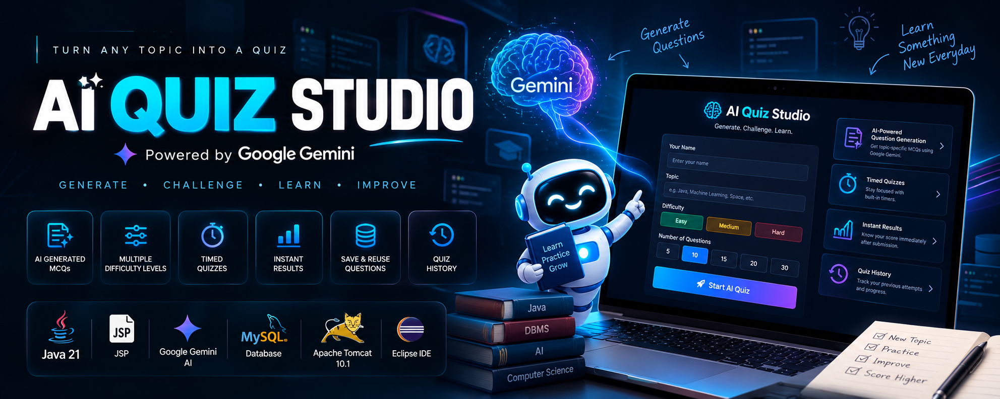

<p align="center">
  
</p>

<h1 align="center">🧠 AI Quiz Studio</h1>

<p align="center">
  <strong>Generate. Challenge. Learn.</strong>
</p>

<p align="center">
  An AI-powered quiz application that combines Google's Gemini API, Java Server Pages, and MySQL to generate topic-specific multiple-choice questions, evaluate quiz attempts, and maintain a history of results.
</p>

<p align="center">
  <a href="https://github.com/TanmayT134/AI-Quiz-Application">
    
  </a>
  
  
  
  
</p>

---

# 📖 Overview

**AI Quiz Studio** is a Java-based web application that uses Google's Gemini API to generate multiple-choice questions according to a user's selected topic and difficulty level.

Built on an Eclipse Dynamic Web Project with JSP, Java 21, Apache Tomcat 10.1, and MySQL, the application demonstrates how generative AI can be integrated into a traditional Java web application.

Users can enter their name, choose a topic, select a difficulty, and start a timed quiz. The application checks its question bank before requesting additional questions from Gemini, stores generated questions for reuse, evaluates submitted answers on the server, and records the final score.

The project focuses on combining **AI integration, relational database operations, server-side processing, and interactive web development** in a single application.

---

# ✨ Key Features

<table>
<tr>
<td width="50%" valign="top">

### 🤖 AI Question Generation

- Gemini API integration
- Topic-specific MCQs
- Easy, Medium, and Hard difficulty
- Four answer options per question
- Correct answer and explanation
- Validation of generated question records

</td>
<td width="50%" valign="top">

### 📝 Custom Quiz Setup

- User-entered name
- Custom topic selection
- Three difficulty levels
- Question count selection
- Server-side input validation
- Random question selection

</td>
</tr>
<tr>
<td width="50%" valign="top">

### ⏱️ Timed Assessments

- Difficulty-based time limits
- Live countdown timer
- Visual timer warnings
- Automatic submission on expiration
- Unanswered questions treated as incorrect

</td>
<td width="50%" valign="top">

### 📊 Results & History

- Automatic answer evaluation
- Score calculation
- Percentage calculation
- Completed quiz results
- Persistent quiz history
- Take-another-quiz navigation

</td>
</tr>
<tr>
<td width="50%" valign="top">

### 🗄️ Database Integration

- MySQL persistence
- Generated question storage
- Quiz attempt records
- Attempt-to-question relationships
- Reuse of existing questions
- Transactional creation of quiz attempts

</td>
<td width="50%" valign="top">

### 🔐 Configuration & Output Safety

- Environment-based API configuration
- Environment-based database credentials
- Server-side Gemini API requests
- HTML output escaping
- Prepared statements for application queries

</td>
</tr>
</table>

---

# 🎯 How It Works

AI Quiz Studio follows a straightforward workflow from quiz configuration to result generation.

```text
┌───────────────────────────────┐
│        Open AI Quiz Studio    │
└───────────────┬───────────────┘
                │
                ▼
┌───────────────────────────────┐
│ Enter Name, Topic, Difficulty │
│       and Question Count      │
└───────────────┬───────────────┘
                │
                ▼
┌───────────────────────────────┐
│       Check MySQL Bank        │
│   for Available Questions     │
└───────────────┬───────────────┘
                │
                ▼
        Enough Questions?
          /           \
        Yes            No
         │              │
         │              ▼
         │     ┌─────────────────────┐
         │     │   Gemini API Call   │
         │     │  Generate MCQs      │
         │     └──────────┬──────────┘
         │                │
         │                ▼
         │     ┌─────────────────────┐
         │     │ Validate & Store    │
         │     │ Generated Questions │
         │     └──────────┬──────────┘
         │                │
         └────────┬───────┘
                  │
                  ▼
       ┌──────────────────────┐
       │ Select Random MCQs   │
       │ Create Quiz Attempt  │
       └──────────┬───────────┘
                  │
                  ▼
       ┌──────────────────────┐
       │  Timed Quiz Session  │
       └──────────┬───────────┘
                  │
                  ▼
       ┌──────────────────────┐
       │ Evaluate Submitted   │
       │ Answers on Server    │
       └──────────┬───────────┘
                  │
                  ▼
       ┌──────────────────────┐
       │ Save Score & Show    │
       │ Quiz Results         │
       └──────────┬───────────┘
                  │
                  ▼
       ┌──────────────────────┐
       │ View Quiz History    │
       └──────────────────────┘
```

---

# 🧠 Gemini-Powered Question Generation

The application uses the Gemini REST API to generate multiple-choice questions dynamically.

When a quiz is requested, the application checks whether enough questions exist for the selected topic and difficulty.

If more questions are needed, Gemini is requested to generate question records in a structured, pipe-delimited format:

```text
QUESTION|OPTION_A|OPTION_B|OPTION_C|OPTION_D|CORRECT|EXPLANATION
```

The application validates the generated records before saving them. It checks the number of fields, required question and option values, and the accepted answer labels (`A`, `B`, `C`, or `D`).

Invalid records are excluded from the usable set. The application retries temporary Gemini API failures and reports an error if it cannot obtain enough valid questions.

Generated questions are stored in MySQL and can be reused in subsequent quizzes for the same topic and difficulty.

> **Important:** AI-generated questions and answer keys can still contain errors. The application's validation checks the response format, not the factual correctness of every generated answer.

---

# 📝 Quiz Configuration

Users configure a quiz using the following fields:

| Field | Available Values |
|---|---|
| **Name** | User-entered name |
| **Topic** | User-entered topic, up to 100 characters |
| **Difficulty** | Easy, Medium, Hard |
| **Question Count** | 5, 10, 15, 20, or 30 |

The server validates the name, topic, difficulty, and question count before creating an attempt. The server-side question-count limit is **1–30**, even though the current interface offers preset choices.

---

# ⏱️ Timed Quiz System

Each quiz receives a time limit based on its difficulty and number of questions.

| Difficulty | Time per Question |
|---|---:|
| 🟢 Easy | 30 seconds |
| 🟡 Medium | 45 seconds |
| 🔴 Hard | 60 seconds |

The total duration is calculated using the selected question count.

For example, a 10-question Medium quiz has a total duration of 7 minutes and 30 seconds.

The remaining time is stored in the server-side session and displayed through a countdown timer in the browser.

When the timer expires, the form is submitted automatically. Unanswered questions are evaluated as incorrect.

---

# 📊 Scoring & Results

After submission, the application retrieves the correct answer for each question from MySQL and evaluates the submitted answers on the server.

The score is calculated as:

\[
\text{Percentage} =
\frac{\text{Correct Answers}}{\text{Total Questions}}
\times 100
\]

The result page displays:

- Participant name
- Quiz topic
- Difficulty
- Score
- Percentage
- Feedback based on the achieved percentage

The completed result is saved in the database so it can be accessed through the quiz history page.

---

# 🗄️ Database Design

The uploaded project and the current GitHub source contain a database-schema discrepancy that must be understood before setup.

## Current JSP Database Workflow

The JSP application currently uses these tables:

| Table | Purpose |
|---|---|
| `questions` | Stores question text, answer options, correct answer, explanation, topic, and difficulty |
| `attempts` | Stores participant name, topic, difficulty, question count, score, percentage, and creation time |
| `attempt_questions` | Associates questions with quiz attempts and stores question ordering |

The `index.jsp` page creates these legacy tables with `CREATE TABLE IF NOT EXISTS` when a quiz is started, then inserts and retrieves records from them.

The quiz and result pages also query these same table names.

## Newer Schema File

The repository also includes `database/schema.sql`, which defines a different set of tables:

- `ai_questions`
- `quiz_attempts`
- `quiz_attempt_questions`

These tables are **not interchangeable** with the table names currently referenced by the JSP pages.

Before relying on `database/schema.sql` as the database setup for this JSP implementation, update the JSP database queries and table-creation logic to use the newer schema consistently, or revise the schema file to match the current application.

The existing `questions` and `quiz_results` tables are not dropped by `database/schema.sql`; nevertheless, always back up important database data before making schema changes.

---

# 🛠️ Technology Stack

<p>


</p>

| Category | Technology |
|---|---|
| Programming Language | Java 21 |
| Web Technology | JavaServer Pages (JSP) |
| Web Container | Apache Tomcat 10.1 |
| Web Module | Dynamic Web Module 6.0 |
| AI Integration | Google Gemini REST API |
| HTTP Client | Java `HttpClient` |
| Database | MySQL 8.x |
| Database Driver | MySQL Connector/J 8.4.0 |
| IDE | Eclipse IDE for Enterprise Java and Web Developers |
| Configuration | Environment variables |
| Version Control | Git & GitHub |

---

# 📂 Project Structure

The repository is based on an Eclipse Dynamic Web Project.

```text
AI-Quiz-Application/
│
├── database/
│   └── schema.sql
│
├── src/
│   └── main/
│       └── webapp/
│           │
│           ├── index.jsp
│           ├── quiz.jsp
│           ├── result.jsp
│           ├── history.jsp
│           │
│           ├── META-INF/
│           │   └── MANIFEST.MF
│           │
│           └── WEB-INF/
│               ├── web.xml
│               └── lib/
│                   └── mysql-connector-j-8.4.0.jar
│
├── .classpath
├── .gitignore
├── .project
├── README.md
└── README_SETUP.md
```

> **Note:** The uploaded ZIP contains an empty `src/main/java/` directory. The current web workflow is implemented in JSP pages, with Java code embedded in JSP scriptlets, rather than in separate Java servlet, service, or repository classes.

---

# ⚙️ Prerequisites

Before running the application, install and configure:

- **Java Development Kit (JDK) 21**
- **Eclipse IDE for Enterprise Java and Web Developers**
- **Apache Tomcat 10.1**
- **MySQL Server 8.x**
- **MySQL Workbench** (recommended)
- A Google Gemini API key from Google AI Studio

You will also need the MySQL Connector/J driver included in the project.

---

# 🚀 Installation & Setup

## 1️⃣ Clone the Repository

```bash
git clone https://github.com/TanmayT134/AI-Quiz-Application.git
```

Open the cloned folder:

```bash
cd AI-Quiz-Application
```

---

## 2️⃣ Import into Eclipse

1. Open Eclipse IDE.
2. Select **File → Import → General → Existing Projects into Workspace**.
3. Select the cloned project directory.
4. Finish the import process.
5. Verify that the project uses Java 21 and Dynamic Web Module 6.0.
6. Configure Apache Tomcat 10.1 as the target runtime.

The Eclipse project metadata currently uses the project name `QuizApplication_Gemini`, while the configured web context is `QuizApplication`.

If Eclipse does not recognize the project correctly, create a Dynamic Web Project targeting Tomcat 10.1 and copy the relevant source and configuration files into it.

---

## 3️⃣ Configure MySQL

Ensure that MySQL Server is running and that the `quiz_db` database exists.

If the database has not been created, execute:

```sql
CREATE DATABASE quiz_db;
```

The current JSP workflow creates the legacy `questions`, `attempts`, and `attempt_questions` tables automatically when a quiz is started.

**Database setup warning:** `database/schema.sql` defines the newer `ai_questions`, `quiz_attempts`, and `quiz_attempt_questions` schema. Do not assume that running this script alone configures the current JSP workflow correctly; align the JSP queries and schema before using it as the sole initialization method.

---

## 4️⃣ Configure Environment Variables

The application reads the Gemini API key and MySQL connection settings from environment variables.

Configure the following variables in the environment used to launch Eclipse/Tomcat:

| Variable | Purpose |
|---|---|
| `GEMINI_API_KEY` | Gemini API key |
| `GEMINI_MODEL` | Gemini model identifier |
| `QUIZ_DB_URL` | MySQL JDBC connection URL |
| `QUIZ_DB_USER` | MySQL username |
| `QUIZ_DB_PASSWORD` | MySQL password |

The JSP code uses these defaults where applicable:

```text
GEMINI_MODEL = gemini-3.8-flash
QUIZ_DB_URL  = jdbc:mysql://localhost:3306/quiz_db?useSSL=false&allowPublicKeyRetrieval=true&serverTimezone=UTC
QUIZ_DB_USER = root
```

The Gemini model can be overridden through `GEMINI_MODEL`. Confirm that the configured model identifier is available to your Google AI Studio API key.

### Windows Command Prompt

Set the variables in a Command Prompt session before starting Eclipse:

```bat
set GEMINI_API_KEY=YOUR_GEMINI_API_KEY
set GEMINI_MODEL=YOUR_SUPPORTED_GEMINI_MODEL
set QUIZ_DB_USER=root
set QUIZ_DB_PASSWORD=YOUR_MYSQL_PASSWORD
set QUIZ_DB_URL=jdbc:mysql://localhost:3306/quiz_db?useSSL=false&allowPublicKeyRetrieval=true&serverTimezone=UTC

eclipse
```

Replace the placeholder values with your own configuration.

**Important:** Environment variables set in a new terminal do not update an Eclipse instance that is already running. Fully close Eclipse and launch it from the configured terminal, or configure the variables at the operating-system level and restart Eclipse.

---

## 5️⃣ Run the Application

1. Right-click the project in Eclipse.
2. Select **Run As → Run on Server**.
3. Choose **Apache Tomcat 10.1**.
4. Finish the server setup and start the application.
5. Open the application in your browser.

Default local URL:

```text
http://localhost:8080/QuizApplication/
```

Use the context path shown in Eclipse if it differs.

---

# 🎮 How to Use

### Step 1 — Enter Quiz Details

Enter a name and choose a topic, difficulty, and number of questions.

### Step 2 — Start the Quiz

Select **Start AI Quiz**. The application checks the question bank and generates additional MCQs through Gemini if required.

### Step 3 — Answer the Questions

Choose an answer for each question before the timer expires.

### Step 4 — Submit the Quiz

Submit your answers manually or allow the timer to submit the quiz automatically.

### Step 5 — Review the Result

View your score, percentage, topic, difficulty, and feedback.

### Step 6 — Explore Quiz History

Use **View Quiz History** to inspect previously completed attempts.

### Step 7 — Start Another Quiz

Return to the home page to select a different topic or difficulty.

---

# 🔐 Security Considerations

The project uses environment variables to keep the Gemini API key and database password out of the Java source code.

Follow these precautions:

- Never commit a real Gemini API key to GitHub.
- Never commit a real MySQL password to GitHub.
- Keep secrets outside JSP-rendered HTML and client-side JavaScript.
- Use a dedicated MySQL account with only the required permissions instead of relying on the root account.
- Rotate any credential that has previously been exposed in source code.
- Do not reuse passwords from the original supplied project.
- Restrict public access before deploying the application for real users.

## ⚠️ Authentication Limitation

The current application asks users to enter a name, but it does not implement a full authenticated user-account system.

The quiz history is global rather than restricted to a verified individual account. This is acceptable for a learning demonstration but is not sufficient for a public production application.

Before public deployment, implement proper authentication, authorization, session protection, and user-specific history access.

## ⚠️ AI Reliability

Gemini-generated answer keys can be incorrect even when the response format passes validation.

For that reason, the application should be treated as a learning and practice tool—not as a validated assessment system for high-stakes examinations.

---

# 🧰 Troubleshooting

### Gemini API error

Check the following:

- `GEMINI_API_KEY` is configured in the environment used by Tomcat.
- The configured Gemini model is available to your account.
- Your system has network access.
- The API key has not expired or been revoked.
- You have sufficient API quota.

The key is sent server-side through the `x-goog-api-key` request header.

### Database access denied

Verify:

- MySQL Server is running.
- The database name is `quiz_db`.
- `QUIZ_DB_USER` is correct.
- `QUIZ_DB_PASSWORD` is correct.
- `QUIZ_DB_URL` points to the correct host and port.

### No questions available

Check the selected topic and difficulty, then verify that Gemini API requests are succeeding.

Generated questions are stored only after the response has been parsed and enough valid records have been obtained.

### Repeated questions

Question reuse is intentional. The application selects questions randomly from the available pool, but a small question bank cannot guarantee that every attempt will contain entirely new questions.

### Eclipse cannot find Tomcat

Install or configure the Apache Tomcat 10.1 server runtime through Eclipse's server settings and ensure that the project targets the correct runtime.

### Database schema errors

The current JSP pages reference `questions`, `attempts`, and `attempt_questions`, whereas `database/schema.sql` creates `ai_questions`, `quiz_attempts`, and `quiz_attempt_questions`.

If an SQL error reports a missing table or column, confirm that the JSP code and database schema target the same table definitions before changing existing data.

---

# 🛣️ Future Enhancements

Potential improvements include:

### 🔐 Authentication & Authorization

- Customer registration and login
- Password hashing
- User-specific quiz history
- Session security
- Access control

### 🧠 AI Improvements

- Stronger question validation
- More robust JSON-based structured responses
- Better duplicate detection
- Improved answer-key verification
- Question-bank quality controls
- Configurable question-generation limits

### 📊 Learning Analytics

- Topic-wise performance
- Difficulty-wise performance
- Historical score trends
- Incorrect-answer review
- Detailed answer explanations

### 🏗️ Architecture

- Move business logic out of JSP scriptlets
- Add Jakarta Servlets as request controllers
- Introduce service and repository layers
- Centralize database access
- Add automated tests
- Keep schema migrations consistent

### 🚀 Deployment

- Production environment configuration
- Centralized logging
- Connection pooling
- Improved error reporting
- Secure deployment configuration

---

# 🎓 Learning Outcomes

This project demonstrates practical application of:

- Java 21
- JavaServer Pages
- Eclipse Dynamic Web Projects
- Apache Tomcat
- MySQL and JDBC
- HTTP client programming
- REST API integration
- Generative AI
- Server-side validation
- SQL queries and persistence
- Quiz timers and sessions
- Transaction management
- Environment-based configuration
- HTML output encoding
- Git and GitHub

---

# 🤝 Contributing

Suggestions and improvements are welcome.

To contribute:

1. Fork the repository.
2. Create a feature branch.
3. Make your changes.
4. Test the application locally.
5. Commit your changes.
6. Push your branch.
7. Open a Pull Request.

---

# 🙏 Acknowledgements

This project uses the following technologies and tools.

<p>


</p>

Special thanks to the open-source communities behind Java, MySQL, Apache Tomcat, and the tools that support AI-assisted application development.

---

# 👨‍💻 Developer

**Tanmay Tawade**

**Artificial Intelligence • Full-Stack Development • Java • Software Engineering**

<p>

<a href="https://github.com/TanmayT134">

</a>

<a href="https://www.linkedin.com/in/tanmay-tawade-995829344/">

</a>

<a href="https://portfolio-tanmay-tawade.vercel.app/">

</a>

</p>

---

# ⭐ Support

If you find this project useful or interesting:

- ⭐ Star the repository
- 🍴 Fork the project
- 💬 Share feedback or suggestions
- 🤝 Contribute improvements

---

<p align="center">

<strong>AI Quiz Studio</strong>

<br>

Generate questions. Challenge yourself. Keep learning.

<br><br>

Made with ❤️ by <strong>Tanmay Tawade</strong>

</p>